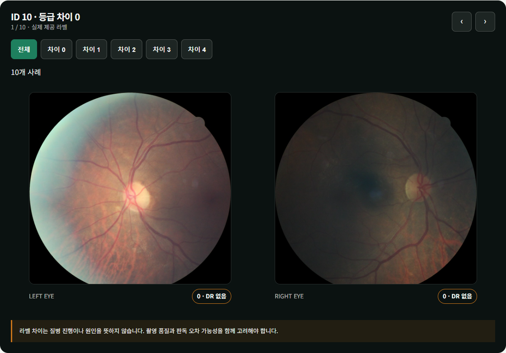

<div align="center">

# Retina Bilateral Analysis

### 같은 사람의 두 눈은 항상 같은 당뇨망막병증 등급일까?

35,126개 안저 라벨을 17,563개의 좌·우 쌍으로 다시 구성해<br>
양안 등급 일치도, 차이 분포, 순서형 합의를 재현 가능하게 분석합니다.

[](https://github.com/dael0207/retina-bilateral-analysis/actions/workflows/checks.yml)


[준비된 결과 받기](https://github.com/dael0207/retina-bilateral-analysis/releases/latest) · [집계 결과](results/summary.json) · [분류 모델 과제](https://github.com/dael0207/retina-grade-classifier)

</div>



## 설치 없이 HTML로 시연하기

[**HTML 시연 소스와 자산**](html-demo/) · [**배포된 웹 시연**](https://retina-bilateral-dael0207.daelj.chatgpt.site) · [**HTML ZIP 다운로드**](https://github.com/dael0207/retina-bilateral-analysis/releases/download/v1.1.0/assignment1-html.zip)

저장소를 내려받아 `html-demo/index.html`을 브라우저로 열면 됩니다. 양안 사례 10쌍의 등급 차이 필터, 차트, 집계 JSON과 PDF 보고서가 모두 포함되어 있어 Python 설치가 필요 없습니다.

> 배포 사이트는 현재 소유자 전용입니다. 교수님 등 다른 사람이 웹 링크를 열려면 사이트 공유 범위를 별도로 변경해야 합니다. GitHub 저장소와 릴리스도 비공개입니다.

## 결과 한눈에 보기

| 지표 | 결과 | 의미 |
|---|---:|---|
| 완전한 좌·우 쌍 | **17,563명 / 35,126안** | 모든 ID에 좌·우 라벨이 한 장씩 존재 |
| 정확 등급 일치 | **87.25%** | 좌·우 등급이 같은 환자 비율 |
| 등급 불일치 | **2,240명 · 12.75%** | 한 단계 이상 차이가 있는 환자 |
| 2단계 이상 차이 | **755명** | 큰 라벨 차이를 보인 환자 |
| 양안 QWK | **0.855** | 순서형 등급의 가중 일치도 |
| DR≥1 환자 내 일치 | **58.58%** | 적어도 한 눈이 1등급 이상인 5,408명 기준 |

가장 중요한 관찰은 “전체 일치율이 높다”와 “질환 라벨이 있는 집단에서도 두 눈이 늘 같지는 않다”가 동시에 참이라는 점입니다. 두 눈을 독립 샘플처럼 섞기보다 환자 ID를 분석 단위로 다뤄야 하는 이유를 수치로 보여 줍니다.

## 무엇을 분석했나

```text
trainLabels.csv
      │  image 이름에서 patient_id / left / right 분리
      ▼
17,563 bilateral pairs
      ├─ 0~4 등급별 이미지 분포
      ├─ 좌·우 5×5 교차표
      ├─ |left - right| 차이 분포
      ├─ Wilson 95% 신뢰구간
      └─ quadratic weighted kappa
```

분석은 예측 모델이 아니라 제공된 라벨 사이의 관계를 계산합니다. 양안 차이는 질병 진행의 원인이나 생물학적 비대칭을 증명하지 않습니다. 촬영 품질과 판독 오차가 함께 영향을 줄 수 있습니다.

## 가장 빠르게 보기

코드 실행 없이 결과를 보고 싶다면 [최신 Release](https://github.com/dael0207/retina-bilateral-analysis/releases/latest)의 `assignment1.zip`을 받습니다.

1. `report.pdf`에서 7쪽 분석 보고서를 읽습니다.
2. `outputs/assignment1/viewer.html`을 더블클릭합니다.
3. 등급 차이 0–4 필터로 실제 양안 사례를 탐색합니다.

릴리스 ZIP에는 실행에 필요한 오프라인 뷰어와 사례용 파생 이미지가 포함됩니다. Git 저장소에는 데이터 재배포 경계를 지키기 위해 원본·소스 해상도의 개별 안저 이미지 파일을 넣지 않습니다.

## 소스에서 재현하기

### 1. 환경 준비

Python 3.12와 [uv](https://docs.astral.sh/uv/)가 필요합니다.

```powershell
git clone https://github.com/dael0207/retina-bilateral-analysis.git
cd retina-bilateral-analysis
uv sync --locked
```

### 2. 라벨 배치

`image,level` 열이 있는 `trainLabels.csv`를 저장소 루트에 둡니다. 원본 데이터와 이용 조건은 [DATA.md](DATA.md)를 확인하세요.

### 3. 분석 실행

```powershell
uv run --frozen python -m retina.analysis trainLabels.csv outputs/assignment1
```

생성 파일:

- `summary.json` — 핵심 수치와 신뢰구간
- `pairs.csv` — 환자별 좌·우 등급과 차이
- `examples.json` — 차이 0–4의 결정론적 사례 선택 기록
- `01_*.png`–`04_*.png` — 보고서용 차트
- `viewer.html` — 최신 JSON을 내장한 독립 실행형 뷰어

`viewer.html`의 사례 사진은 `outputs/assignment1/images/{image}.jpg`에서 읽습니다. 소스 저장소는 원본 사진을 제공하지 않으므로, 사진까지 포함된 화면은 릴리스 ZIP을 사용하거나 정당하게 보유한 이미지의 파생본을 해당 폴더에 준비해야 합니다.

## 검증

```powershell
uv run --frozen pytest -q
uv run --frozen ruff check retina tests
uv run --frozen ruff format --check retina tests
uv run --frozen basedpyright
```

저장소 테스트는 원본 안저 자료 없이 합성 fixture로 실행됩니다. 실제 자료가 있을 때만 원본 35,126개 라벨 불변성 검사가 추가로 실행됩니다.

## 저장소 구조

```text
retina/
├─ analysis.py                    # 라벨 파싱, 양안 결합, 통계 산출
├─ charts.py                      # 집계 차트 4종
├─ viewer.py                      # 오프라인 HTML 생성
└─ templates/assignment1_viewer.html
tests/                            # 원본 데이터 없는 회귀 테스트
results/                          # 개인 이미지 없는 집계 JSON·차트
docs/images/overview.png          # 비식별 예시가 포함된 검증 화면 캡처
```

## 재현성과 한계

- 좌·우 눈은 파일명의 동일 환자 ID로 결합합니다.
- 예시는 등급 차이마다 낮은 중증도와 높은 중증도 쌍을 정해진 규칙으로 선택합니다.
- 분석 결과는 의료 진단이나 임상적 인과 추론이 아닙니다.
- 이 저장소에는 별도 소스 라이선스를 선언하지 않았습니다. 제3자 데이터와 라이브러리의 권리는 각 제공자에게 있습니다.

---

<div align="center">
다음 과제: <a href="https://github.com/dael0207/retina-grade-classifier">환자 단위 분리 5등급 분류 앱</a>
</div>
